# Projects and dependencies analysis

This document provides a comprehensive overview of the projects and their dependencies in the context of upgrading to .NETCoreApp,Version=v10.0.

## Table of Contents

- [Executive Summary](#executive-Summary)
  - [Highlevel Metrics](#highlevel-metrics)
  - [Projects Compatibility](#projects-compatibility)
  - [Package Compatibility](#package-compatibility)
  - [API Compatibility](#api-compatibility)
- [Aggregate NuGet packages details](#aggregate-nuget-packages-details)
- [Top API Migration Challenges](#top-api-migration-challenges)
  - [Technologies and Features](#technologies-and-features)
  - [Most Frequent API Issues](#most-frequent-api-issues)
- [Projects Relationship Graph](#projects-relationship-graph)
- [Project Details](#project-details)

  - [EC226.Auth\EC226.Auth.csproj](#ec226authec226authcsproj)
  - [EC226.Caching\EC226.Caching.csproj](#ec226cachingec226cachingcsproj)
  - [EC226.CMS.Api\EC226.CMS.Api.csproj](#ec226cmsapiec226cmsapicsproj)
  - [EC226.CodeGenerator\EC226.CodeGenerator.csproj](#ec226codegeneratorec226codegeneratorcsproj)
  - [EC226.Configuration\EC226.Configuration.csproj](#ec226configurationec226configurationcsproj)
  - [EC226.Core\EC226.Core.csproj](#ec226coreec226corecsproj)
  - [EC226.Filter\EC226.Filter.csproj](#ec226filterec226filtercsproj)
  - [EC226.Loging\EC226.Loging.csproj](#ec226logingec226logingcsproj)
  - [EC226.Mapping\EC226.Mapping.csproj](#ec226mappingec226mappingcsproj)
  - [EC226.MemberSite.Api\EC226.MemberSite.Api.csproj](#ec226membersiteapiec226membersiteapicsproj)
  - [EC226.MemberSite.IRepository\EC226.MemberSite.IRepository.csproj](#ec226membersiteirepositoryec226membersiteirepositorycsproj)
  - [EC226.MemberSite.IServices\EC226.MemberSite.IServices.csproj](#ec226membersiteiservicesec226membersiteiservicescsproj)
  - [EC226.MemberSite.Model\EC226.MemberSite.Model.csproj](#ec226membersitemodelec226membersitemodelcsproj)
  - [EC226.MemberSite.Repository\EC226.MemberSite.Repository.csproj](#ec226membersiterepositoryec226membersiterepositorycsproj)
  - [EC226.MemberSite.Services\EC226.MemberSite.Services.csproj](#ec226membersiteservicesec226membersiteservicescsproj)
  - [EC226.Middlewares\EC226.Middlewares.csproj](#ec226middlewaresec226middlewarescsproj)
  - [EC226.Pagination\EC226.Pagination.csproj](#ec226paginationec226paginationcsproj)
  - [EC226.Payment.Test\EC226.Payment.Test.csproj](#ec226paymenttestec226paymenttestcsproj)
  - [EC226.Payment\EC226.Payment.csproj](#ec226paymentec226paymentcsproj)
  - [EC226.RedisMQ\EC226.RedisMQ.csproj](#ec226redismqec226redismqcsproj)
  - [EC226.Swagger\EC226.Swagger.csproj](#ec226swaggerec226swaggercsproj)
  - [EC226.Task\EC226.Task.csproj](#ec226taskec226taskcsproj)
  - [EC226.Utility\EC226.Utility.csproj](#ec226utilityec226utilitycsproj)


## Executive Summary

### Highlevel Metrics

| Metric | Count | Status |
| :--- | :---: | :--- |
| Total Projects | 23 | All require upgrade |
| Total NuGet Packages | 69 | 22 need upgrade |
| Total Code Files | 501 |  |
| Total Code Files with Incidents | 48 |  |
| Total Lines of Code | 50796 |  |
| Total Number of Issues | 260 |  |
| Estimated LOC to modify | 197+ | at least 0.4% of codebase |

### Projects Compatibility

| Project | Target Framework | Difficulty | Package Issues | API Issues | Est. LOC Impact | Description |
| :--- | :---: | :---: | :---: | :---: | :---: | :--- |
| [EC226.Auth\EC226.Auth.csproj](#ec226authec226authcsproj) | net8.0 | 🟡 Medium | 2 | 79 | 79+ | ClassLibrary, Sdk Style = True |
| [EC226.Caching\EC226.Caching.csproj](#ec226cachingec226cachingcsproj) | net8.0 | 🟢 Low | 2 | 7 | 7+ | ClassLibrary, Sdk Style = True |
| [EC226.CMS.Api\EC226.CMS.Api.csproj](#ec226cmsapiec226cmsapicsproj) | net8.0 | 🟢 Low | 8 | 9 | 9+ | AspNetCore, Sdk Style = True |
| [EC226.CodeGenerator\EC226.CodeGenerator.csproj](#ec226codegeneratorec226codegeneratorcsproj) | net8.0 | 🟢 Low | 0 | 0 |  | ClassLibrary, Sdk Style = True |
| [EC226.Configuration\EC226.Configuration.csproj](#ec226configurationec226configurationcsproj) | net8.0 | 🟢 Low | 3 | 0 |  | ClassLibrary, Sdk Style = True |
| [EC226.Core\EC226.Core.csproj](#ec226coreec226corecsproj) | net8.0 | 🟢 Low | 2 | 22 | 22+ | ClassLibrary, Sdk Style = True |
| [EC226.Filter\EC226.Filter.csproj](#ec226filterec226filtercsproj) | net8.0 | 🟢 Low | 1 | 0 |  | ClassLibrary, Sdk Style = True |
| [EC226.Loging\EC226.Loging.csproj](#ec226logingec226logingcsproj) | net8.0 | 🟢 Low | 2 | 0 |  | ClassLibrary, Sdk Style = True |
| [EC226.Mapping\EC226.Mapping.csproj](#ec226mappingec226mappingcsproj) | net8.0 | 🟢 Low | 1 | 0 |  | ClassLibrary, Sdk Style = True |
| [EC226.MemberSite.Api\EC226.MemberSite.Api.csproj](#ec226membersiteapiec226membersiteapicsproj) | net8.0 | 🟢 Low | 7 | 5 | 5+ | AspNetCore, Sdk Style = True |
| [EC226.MemberSite.IRepository\EC226.MemberSite.IRepository.csproj](#ec226membersiteirepositoryec226membersiteirepositorycsproj) | net8.0 | 🟢 Low | 0 | 0 |  | ClassLibrary, Sdk Style = True |
| [EC226.MemberSite.IServices\EC226.MemberSite.IServices.csproj](#ec226membersiteiservicesec226membersiteiservicescsproj) | net8.0 | 🟢 Low | 1 | 0 |  | ClassLibrary, Sdk Style = True |
| [EC226.MemberSite.Model\EC226.MemberSite.Model.csproj](#ec226membersitemodelec226membersitemodelcsproj) | net8.0 | 🟢 Low | 1 | 0 |  | ClassLibrary, Sdk Style = True |
| [EC226.MemberSite.Repository\EC226.MemberSite.Repository.csproj](#ec226membersiterepositoryec226membersiterepositorycsproj) | net8.0 | 🟢 Low | 0 | 0 |  | ClassLibrary, Sdk Style = True |
| [EC226.MemberSite.Services\EC226.MemberSite.Services.csproj](#ec226membersiteservicesec226membersiteservicescsproj) | net8.0 | 🟢 Low | 4 | 0 |  | ClassLibrary, Sdk Style = True |
| [EC226.Middlewares\EC226.Middlewares.csproj](#ec226middlewaresec226middlewarescsproj) | net8.0 | 🟢 Low | 0 | 0 |  | ClassLibrary, Sdk Style = True |
| [EC226.Pagination\EC226.Pagination.csproj](#ec226paginationec226paginationcsproj) | net8.0 | 🟢 Low | 1 | 0 |  | AspNetCore, Sdk Style = True |
| [EC226.Payment.Test\EC226.Payment.Test.csproj](#ec226paymenttestec226paymenttestcsproj) | net8.0 | 🟢 Low | 0 | 2 | 2+ | DotNetCoreApp, Sdk Style = True |
| [EC226.Payment\EC226.Payment.csproj](#ec226paymentec226paymentcsproj) | net8.0 | 🟢 Low | 0 | 59 | 59+ | ClassLibrary, Sdk Style = True |
| [EC226.RedisMQ\EC226.RedisMQ.csproj](#ec226redismqec226redismqcsproj) | net8.0 | 🟢 Low | 0 | 0 |  | ClassLibrary, Sdk Style = True |
| [EC226.Swagger\EC226.Swagger.csproj](#ec226swaggerec226swaggercsproj) | net8.0 | 🟢 Low | 1 | 0 |  | ClassLibrary, Sdk Style = True |
| [EC226.Task\EC226.Task.csproj](#ec226taskec226taskcsproj) | net8.0 | 🟢 Low | 1 | 0 |  | ClassLibrary, Sdk Style = True |
| [EC226.Utility\EC226.Utility.csproj](#ec226utilityec226utilitycsproj) | net8.0 | 🟢 Low | 3 | 14 | 14+ | ClassLibrary, Sdk Style = True |

### Package Compatibility

| Status | Count | Percentage |
| :--- | :---: | :---: |
| ✅ Compatible | 47 | 68.1% |
| ⚠️ Incompatible | 7 | 10.1% |
| 🔄 Upgrade Recommended | 15 | 21.7% |
| ***Total NuGet Packages*** | ***69*** | ***100%*** |

### API Compatibility

| Category | Count | Impact |
| :--- | :---: | :--- |
| 🔴 Binary Incompatible | 65 | High - Require code changes |
| 🟡 Source Incompatible | 87 | Medium - Needs re-compilation and potential conflicting API error fixing |
| 🔵 Behavioral change | 45 | Low - Behavioral changes that may require testing at runtime |
| ✅ Compatible | 48128 |  |
| ***Total APIs Analyzed*** | ***48325*** |  |

## Aggregate NuGet packages details

| Package | Current Version | Suggested Version | Projects | Description |
| :--- | :---: | :---: | :--- | :--- |
| Amazon.Pay.API.SDK | 2.7.2 |  | [EC226.MemberSite.Services.csproj](#ec226membersiteservicesec226membersiteservicescsproj) | ✅Compatible |
| Autofac.Extensions.DependencyInjection | 9.0.0 |  | [EC226.CMS.Api.csproj](#ec226cmsapiec226cmsapicsproj)<br/>[EC226.Core.csproj](#ec226coreec226corecsproj)<br/>[EC226.MemberSite.Api.csproj](#ec226membersiteapiec226membersiteapicsproj) | ✅Compatible |
| Autofac.Extras.DynamicProxy | 7.1.0 |  | [EC226.CMS.Api.csproj](#ec226cmsapiec226cmsapicsproj)<br/>[EC226.Core.csproj](#ec226coreec226corecsproj)<br/>[EC226.MemberSite.Api.csproj](#ec226membersiteapiec226membersiteapicsproj) | ✅Compatible |
| AutoMapper | 12.0.1 |  | [EC226.Configuration.csproj](#ec226configurationec226configurationcsproj)<br/>[EC226.Mapping.csproj](#ec226mappingec226mappingcsproj) | ✅Compatible |
| AutoMapper.Extensions.Microsoft.DependencyInjection | 12.0.1 |  | [EC226.CMS.Api.csproj](#ec226cmsapiec226cmsapicsproj)<br/>[EC226.MemberSite.Api.csproj](#ec226membersiteapiec226membersiteapicsproj) | ⚠️NuGet 套件已過時 |
| Castle.Core | 5.1.1 |  | [EC226.Core.csproj](#ec226coreec226corecsproj) | ✅Compatible |
| ClosedXML | 0.102.2 |  | [EC226.CMS.Api.csproj](#ec226cmsapiec226cmsapicsproj) | ✅Compatible |
| CorrelationId | 3.0.1 |  | [EC226.CMS.Api.csproj](#ec226cmsapiec226cmsapicsproj)<br/>[EC226.MemberSite.Api.csproj](#ec226membersiteapiec226membersiteapicsproj) | ✅Compatible |
| coverlet.collector | 3.2.0 |  | [EC226.Payment.Test.csproj](#ec226paymenttestec226paymenttestcsproj) | ✅Compatible |
| DataAnnotationsValidator | 2.2.0 | 2.3.0 | [EC226.MemberSite.Model.csproj](#ec226membersitemodelec226membersitemodelcsproj)<br/>[EC226.Utility.csproj](#ec226utilityec226utilitycsproj) | ⚠️NuGet 套件不相容 |
| DotLiquid | 2.2.692 |  | [EC226.CodeGenerator.csproj](#ec226codegeneratorec226codegeneratorcsproj)<br/>[EC226.MemberSite.Repository.csproj](#ec226membersiterepositoryec226membersiterepositorycsproj) | ✅Compatible |
| FluentAssertions | 6.10.0 |  | [EC226.Payment.Test.csproj](#ec226paymenttestec226paymenttestcsproj) | ✅Compatible |
| Flurl.Http | 4.0.2 |  | [EC226.MemberSite.Services.csproj](#ec226membersiteservicesec226membersiteservicescsproj) | ✅Compatible |
| Hangfire | 1.8.12 |  | [EC226.CMS.Api.csproj](#ec226cmsapiec226cmsapicsproj)<br/>[EC226.Core.csproj](#ec226coreec226corecsproj)<br/>[EC226.MemberSite.Api.csproj](#ec226membersiteapiec226membersiteapicsproj)<br/>[EC226.Task.csproj](#ec226taskec226taskcsproj) | ✅Compatible |
| Hangfire.AspNetCore | 1.8.12 |  | [EC226.CMS.Api.csproj](#ec226cmsapiec226cmsapicsproj)<br/>[EC226.Core.csproj](#ec226coreec226corecsproj)<br/>[EC226.MemberSite.Api.csproj](#ec226membersiteapiec226membersiteapicsproj) | ✅Compatible |
| Hangfire.Core | 1.8.12 |  | [EC226.CMS.Api.csproj](#ec226cmsapiec226cmsapicsproj)<br/>[EC226.Core.csproj](#ec226coreec226corecsproj)<br/>[EC226.MemberSite.Api.csproj](#ec226membersiteapiec226membersiteapicsproj) | ✅Compatible |
| Hangfire.Dashboard.BasicAuthorization | 1.0.2 |  | [EC226.CMS.Api.csproj](#ec226cmsapiec226cmsapicsproj)<br/>[EC226.Core.csproj](#ec226coreec226corecsproj)<br/>[EC226.MemberSite.Api.csproj](#ec226membersiteapiec226membersiteapicsproj) | ✅Compatible |
| Hangfire.MySqlStorage | 2.0.3 |  | [EC226.Core.csproj](#ec226coreec226corecsproj) | ✅Compatible |
| Hangfire.Redis.StackExchange | 1.9.3 |  | [EC226.CMS.Api.csproj](#ec226cmsapiec226cmsapicsproj)<br/>[EC226.Core.csproj](#ec226coreec226corecsproj)<br/>[EC226.MemberSite.Api.csproj](#ec226membersiteapiec226membersiteapicsproj) | ✅Compatible |
| InitQ | 1.0.0.18 |  | [EC226.Core.csproj](#ec226coreec226corecsproj)<br/>[EC226.RedisMQ.csproj](#ec226redismqec226redismqcsproj) | ✅Compatible |
| Microsoft.AspNetCore.Authentication.JwtBearer | 8.0.4 | 10.0.1 | [EC226.Auth.csproj](#ec226authec226authcsproj) | 建議升級 NuGet 套件 |
| Microsoft.AspNetCore.Http.Abstractions | 2.2.0 |  | [EC226.MemberSite.Services.csproj](#ec226membersiteservicesec226membersiteservicescsproj) | ⚠️NuGet 套件已過時 |
| Microsoft.AspNetCore.Http.Features | 5.0.17 |  | [EC226.MemberSite.IServices.csproj](#ec226membersiteiservicesec226membersiteiservicescsproj) | ⚠️NuGet 套件已過時 |
| Microsoft.AspNetCore.Mvc.Core | 2.2.5 |  | [EC226.Filter.csproj](#ec226filterec226filtercsproj)<br/>[EC226.Swagger.csproj](#ec226swaggerec226swaggercsproj) | ⚠️NuGet 套件已過時 |
| Microsoft.AspNetCore.Mvc.NewtonsoftJson | 8.0.4 | 10.0.1 | [EC226.CMS.Api.csproj](#ec226cmsapiec226cmsapicsproj)<br/>[EC226.MemberSite.Api.csproj](#ec226membersiteapiec226membersiteapicsproj) | 建議升級 NuGet 套件 |
| Microsoft.AspNetCore.Mvc.Razor.RuntimeCompilation | 8.0.4 | 10.0.1 | [EC226.CMS.Api.csproj](#ec226cmsapiec226cmsapicsproj) | 建議升級 NuGet 套件 |
| Microsoft.Data.SqlClient | 5.2.0 |  | [EC226.CMS.Api.csproj](#ec226cmsapiec226cmsapicsproj)<br/>[EC226.MemberSite.Api.csproj](#ec226membersiteapiec226membersiteapicsproj) | ✅Compatible |
| Microsoft.DotNet.PlatformAbstractions | 3.1.6 |  | [EC226.CMS.Api.csproj](#ec226cmsapiec226cmsapicsproj)<br/>[EC226.MemberSite.Api.csproj](#ec226membersiteapiec226membersiteapicsproj) | ✅Compatible |
| Microsoft.EntityFrameworkCore | 7.0.3 | 10.0.1 | [EC226.Pagination.csproj](#ec226paginationec226paginationcsproj) | 建議升級 NuGet 套件 |
| Microsoft.Extensions.Caching.Memory | 8.0.0 | 10.0.1 | [EC226.Caching.csproj](#ec226cachingec226cachingcsproj) | 建議升級 NuGet 套件 |
| Microsoft.Extensions.Configuration | 8.0.0 | 10.0.1 | [EC226.Configuration.csproj](#ec226configurationec226configurationcsproj) | 建議升級 NuGet 套件 |
| Microsoft.Extensions.Configuration.Binder | 8.0.1 | 10.0.1 | [EC226.Configuration.csproj](#ec226configurationec226configurationcsproj)<br/>[EC226.MemberSite.Api.csproj](#ec226membersiteapiec226membersiteapicsproj) | 建議升級 NuGet 套件 |
| Microsoft.Extensions.Configuration.Json | 8.0.0 | 10.0.1 | [EC226.Configuration.csproj](#ec226configurationec226configurationcsproj)<br/>[EC226.MemberSite.Api.csproj](#ec226membersiteapiec226membersiteapicsproj) | 建議升級 NuGet 套件 |
| Microsoft.Extensions.DependencyInjection | 8.0.0 | 10.0.1 | [EC226.Core.csproj](#ec226coreec226corecsproj) | 建議升級 NuGet 套件 |
| Microsoft.Extensions.DependencyInjection.Abstractions | 8.0.1 | 10.0.1 | [EC226.Auth.csproj](#ec226authec226authcsproj)<br/>[EC226.CMS.Api.csproj](#ec226cmsapiec226cmsapicsproj)<br/>[EC226.Core.csproj](#ec226coreec226corecsproj)<br/>[EC226.Task.csproj](#ec226taskec226taskcsproj) | 建議升級 NuGet 套件 |
| Microsoft.Extensions.Hosting.Abstractions | 8.0.0 | 10.0.1 | [EC226.Loging.csproj](#ec226logingec226logingcsproj)<br/>[EC226.MemberSite.Services.csproj](#ec226membersiteservicesec226membersiteservicescsproj)<br/>[EC226.Utility.csproj](#ec226utilityec226utilitycsproj) | 建議升級 NuGet 套件 |
| Microsoft.Extensions.Options | 8.0.2 | 10.0.1 | [EC226.MemberSite.Services.csproj](#ec226membersiteservicesec226membersiteservicescsproj) | 建議升級 NuGet 套件 |
| Microsoft.NET.Test.Sdk | 17.5.0 |  | [EC226.Payment.Test.csproj](#ec226paymenttestec226paymenttestcsproj) | ✅Compatible |
| Microsoft.OpenApi | 1.6.14 |  | [EC226.Core.csproj](#ec226coreec226corecsproj)<br/>[EC226.Swagger.csproj](#ec226swaggerec226swaggercsproj) | ✅Compatible |
| Microsoft.VisualStudio.Azure.Containers.Tools.Targets | 1.21.0 |  | [EC226.CMS.Api.csproj](#ec226cmsapiec226cmsapicsproj) | ⚠️NuGet 套件不相容 |
| Microsoft.VisualStudio.Web.CodeGeneration.Design | 8.0.2 | 10.0.1 | [EC226.CMS.Api.csproj](#ec226cmsapiec226cmsapicsproj)<br/>[EC226.MemberSite.Api.csproj](#ec226membersiteapiec226membersiteapicsproj) | 建議升級 NuGet 套件 |
| MiniProfiler.AspNetCore.Mvc | 4.3.8 |  | [EC226.Auth.csproj](#ec226authec226authcsproj)<br/>[EC226.Caching.csproj](#ec226cachingec226cachingcsproj)<br/>[EC226.CMS.Api.csproj](#ec226cmsapiec226cmsapicsproj)<br/>[EC226.CodeGenerator.csproj](#ec226codegeneratorec226codegeneratorcsproj)<br/>[EC226.Configuration.csproj](#ec226configurationec226configurationcsproj)<br/>[EC226.Core.csproj](#ec226coreec226corecsproj)<br/>[EC226.Filter.csproj](#ec226filterec226filtercsproj)<br/>[EC226.Loging.csproj](#ec226logingec226logingcsproj)<br/>[EC226.Mapping.csproj](#ec226mappingec226mappingcsproj)<br/>[EC226.MemberSite.Api.csproj](#ec226membersiteapiec226membersiteapicsproj)<br/>[EC226.MemberSite.IRepository.csproj](#ec226membersiteirepositoryec226membersiteirepositorycsproj)<br/>[EC226.MemberSite.IServices.csproj](#ec226membersiteiservicesec226membersiteiservicescsproj)<br/>[EC226.MemberSite.Model.csproj](#ec226membersitemodelec226membersitemodelcsproj)<br/>[EC226.MemberSite.Repository.csproj](#ec226membersiterepositoryec226membersiterepositorycsproj)<br/>[EC226.MemberSite.Services.csproj](#ec226membersiteservicesec226membersiteservicescsproj)<br/>[EC226.Middlewares.csproj](#ec226middlewaresec226middlewarescsproj)<br/>[EC226.RedisMQ.csproj](#ec226redismqec226redismqcsproj)<br/>[EC226.Swagger.csproj](#ec226swaggerec226swaggercsproj)<br/>[EC226.Task.csproj](#ec226taskec226taskcsproj)<br/>[EC226.Utility.csproj](#ec226utilityec226utilitycsproj) | ✅Compatible |
| Newtonsoft.Json | 13.0.3 | 13.0.4 | [EC226.Loging.csproj](#ec226logingec226logingcsproj)<br/>[EC226.Mapping.csproj](#ec226mappingec226mappingcsproj)<br/>[EC226.Utility.csproj](#ec226utilityec226utilitycsproj) | 建議升級 NuGet 套件 |
| Nito.AsyncEx | 5.1.2 |  | [EC226.CMS.Api.csproj](#ec226cmsapiec226cmsapicsproj)<br/>[EC226.MemberSite.Api.csproj](#ec226membersiteapiec226membersiteapicsproj) | ✅Compatible |
| NLog | 5.1.2 |  | [EC226.Pagination.csproj](#ec226paginationec226paginationcsproj) | ✅Compatible |
| NLog | 5.3.1 |  | [EC226.CMS.Api.csproj](#ec226cmsapiec226cmsapicsproj)<br/>[EC226.Loging.csproj](#ec226logingec226logingcsproj)<br/>[EC226.MemberSite.Api.csproj](#ec226membersiteapiec226membersiteapicsproj) | ✅Compatible |
| NLog.Extensions.Logging | 5.3.9 |  | [EC226.CMS.Api.csproj](#ec226cmsapiec226cmsapicsproj)<br/>[EC226.MemberSite.Api.csproj](#ec226membersiteapiec226membersiteapicsproj) | ✅Compatible |
| NLog.Web.AspNetCore | 5.3.9 |  | [EC226.CMS.Api.csproj](#ec226cmsapiec226cmsapicsproj)<br/>[EC226.MemberSite.Api.csproj](#ec226membersiteapiec226membersiteapicsproj) | ✅Compatible |
| NPOI | 2.7.0 |  | [EC226.Utility.csproj](#ec226utilityec226utilitycsproj) | ✅Compatible |
| Qc.YilianyunSdk | 1.0.7 |  | [EC226.CMS.Api.csproj](#ec226cmsapiec226cmsapicsproj)<br/>[EC226.Core.csproj](#ec226coreec226corecsproj)<br/>[EC226.MemberSite.Api.csproj](#ec226membersiteapiec226membersiteapicsproj)<br/>[EC226.MemberSite.Services.csproj](#ec226membersiteservicesec226membersiteservicescsproj)<br/>[EC226.RedisMQ.csproj](#ec226redismqec226redismqcsproj) | ✅Compatible |
| Qiniu | 8.5.0 |  | [EC226.MemberSite.Services.csproj](#ec226membersiteservicesec226membersiteservicescsproj) | ✅Compatible |
| RazorEngine.NetCore | 3.1.0 |  | [EC226.CMS.Api.csproj](#ec226cmsapiec226cmsapicsproj) | ✅Compatible |
| Seq.Client.NLog | 2.3.27 |  | [EC226.CMS.Api.csproj](#ec226cmsapiec226cmsapicsproj)<br/>[EC226.MemberSite.Api.csproj](#ec226membersiteapiec226membersiteapicsproj) | ⚠️NuGet 套件不相容 |
| Seq.Extensions.Logging | 8.0.0 |  | [EC226.MemberSite.Api.csproj](#ec226membersiteapiec226membersiteapicsproj) | ✅Compatible |
| SixLabors.ImageSharp | 3.1.4 | 3.1.12 | [EC226.MemberSite.Services.csproj](#ec226membersiteservicesec226membersiteservicescsproj) | NuGet 套件包含安全性弱點 |
| SixLabors.ImageSharp.Drawing | 2.1.3 |  | [EC226.MemberSite.Services.csproj](#ec226membersiteservicesec226membersiteservicescsproj) | ✅Compatible |
| Snowflake.Core | 2.0.0 |  | [EC226.CMS.Api.csproj](#ec226cmsapiec226cmsapicsproj)<br/>[EC226.MemberSite.Api.csproj](#ec226membersiteapiec226membersiteapicsproj) | ✅Compatible |
| SQLitePCLRaw.bundle_e_sqlite3 | 2.1.8 |  | [EC226.CMS.Api.csproj](#ec226cmsapiec226cmsapicsproj) | ✅Compatible |
| SqlSugar.IOC | 2.0.0 |  | [EC226.CMS.Api.csproj](#ec226cmsapiec226cmsapicsproj)<br/>[EC226.Core.csproj](#ec226coreec226corecsproj)<br/>[EC226.MemberSite.Repository.csproj](#ec226membersiterepositoryec226membersiterepositorycsproj) | ✅Compatible |
| SqlSugarCore | 5.1.4.153 |  | [EC226.CMS.Api.csproj](#ec226cmsapiec226cmsapicsproj)<br/>[EC226.CodeGenerator.csproj](#ec226codegeneratorec226codegeneratorcsproj)<br/>[EC226.Core.csproj](#ec226coreec226corecsproj)<br/>[EC226.MemberSite.Model.csproj](#ec226membersitemodelec226membersitemodelcsproj)<br/>[EC226.Pagination.csproj](#ec226paginationec226paginationcsproj) | ✅Compatible |
| SSH.NET | 2024.0.0 |  | [EC226.CMS.Api.csproj](#ec226cmsapiec226cmsapicsproj) | ✅Compatible |
| StackExchange.Redis | 2.7.33 |  | [EC226.Caching.csproj](#ec226cachingec226cachingcsproj)<br/>[EC226.CMS.Api.csproj](#ec226cmsapiec226cmsapicsproj)<br/>[EC226.MemberSite.Api.csproj](#ec226membersiteapiec226membersiteapicsproj) | ✅Compatible |
| Stripe.net | 45.2.0 |  | [EC226.MemberSite.Api.csproj](#ec226membersiteapiec226membersiteapicsproj)<br/>[EC226.MemberSite.Services.csproj](#ec226membersiteservicesec226membersiteservicescsproj) | ✅Compatible |
| Swashbuckle.AspNetCore | 6.5.0 |  | [EC226.Swagger.csproj](#ec226swaggerec226swaggercsproj) | ✅Compatible |
| Swashbuckle.AspNetCore.Filters | 8.0.1 |  | [EC226.Core.csproj](#ec226coreec226corecsproj) | ✅Compatible |
| Swashbuckle.AspNetCore.Newtonsoft | 6.5.0 |  | [EC226.Core.csproj](#ec226coreec226corecsproj) | ✅Compatible |
| ToolGood.Words | 3.1.0 |  | [EC226.CMS.Api.csproj](#ec226cmsapiec226cmsapicsproj)<br/>[EC226.MemberSite.Api.csproj](#ec226membersiteapiec226membersiteapicsproj)<br/>[EC226.MemberSite.Services.csproj](#ec226membersiteservicesec226membersiteservicescsproj)<br/>[EC226.Utility.csproj](#ec226utilityec226utilitycsproj) | ✅Compatible |
| xunit | 2.4.2 |  | [EC226.Payment.Test.csproj](#ec226paymenttestec226paymenttestcsproj) | ✅Compatible |
| xunit.runner.visualstudio | 2.4.5 |  | [EC226.Payment.Test.csproj](#ec226paymenttestec226paymenttestcsproj) | ✅Compatible |

## Top API Migration Challenges

### Technologies and Features

| Technology | Issues | Percentage | Migration Path |
| :--- | :---: | :---: | :--- |
| IdentityModel & Claims-based Security | 61 | 31.0% | Windows Identity Foundation (WIF), SAML, and claims-based authentication APIs that have been replaced by modern identity libraries. WIF was the original identity framework for .NET Framework. Migrate to Microsoft.IdentityModel.* packages (modern identity stack). |
| Legacy Cryptography | 10 | 5.1% | Obsolete or insecure cryptographic algorithms that have been deprecated for security reasons. These algorithms are no longer considered secure by modern standards. Migrate to modern cryptographic APIs using secure algorithms. |

### Most Frequent API Issues

| API | Count | Percentage | Category |
| :--- | :---: | :---: | :--- |
| T:System.Net.Http.HttpContent | 18 | 9.1% | Behavioral Change |
| T:System.Uri | 14 | 7.1% | Behavioral Change |
| M:System.TimeSpan.FromMinutes(System.Double) | 12 | 6.1% | Source Incompatible |
| F:System.Net.SecurityProtocolType.Ssl3 | 12 | 6.1% | Source Incompatible |
| T:System.Net.ServicePointManager | 12 | 6.1% | Source Incompatible |
| T:System.IdentityModel.Tokens.Jwt.JwtSecurityTokenHandler | 9 | 4.6% | Binary Incompatible |
| M:System.IdentityModel.Tokens.Jwt.JwtSecurityTokenHandler.#ctor | 9 | 4.6% | Binary Incompatible |
| M:System.TimeSpan.FromSeconds(System.Double) | 9 | 4.6% | Source Incompatible |
| T:System.Security.Cryptography.Rijndael | 8 | 4.1% | Source Incompatible |
| M:System.Uri.#ctor(System.String) | 7 | 3.6% | Behavioral Change |
| T:System.IdentityModel.Tokens.Jwt.JwtRegisteredClaimNames | 6 | 3.0% | Binary Incompatible |
| T:System.IdentityModel.Tokens.Jwt.JwtSecurityToken | 6 | 3.0% | Binary Incompatible |
| T:Microsoft.AspNetCore.Hosting.IHostingEnvironment | 6 | 3.0% | Source Incompatible |
| T:System.IdentityModel.Tokens.Jwt.JwtPayload | 4 | 2.0% | Binary Incompatible |
| P:System.IdentityModel.Tokens.Jwt.JwtSecurityToken.Payload | 4 | 2.0% | Binary Incompatible |
| M:System.IdentityModel.Tokens.Jwt.JwtSecurityTokenHandler.ReadJwtToken(System.String) | 4 | 2.0% | Binary Incompatible |
| T:Microsoft.Extensions.DependencyInjection.ServiceCollectionExtensions | 4 | 2.0% | Binary Incompatible |
| M:System.IdentityModel.Tokens.Jwt.JwtSecurityTokenHandler.WriteToken(Microsoft.IdentityModel.Tokens.SecurityToken) | 3 | 1.5% | Binary Incompatible |
| F:System.IdentityModel.Tokens.Jwt.JwtRegisteredClaimNames.Exp | 2 | 1.0% | Binary Incompatible |
| M:System.IdentityModel.Tokens.Jwt.JwtSecurityToken.#ctor(System.String,System.String,System.Collections.Generic.IEnumerable{System.Security.Claims.Claim},System.Nullable{System.DateTime},System.Nullable{System.DateTime},Microsoft.IdentityModel.Tokens.SigningCredentials) | 2 | 1.0% | Binary Incompatible |
| T:Microsoft.AspNetCore.Authentication.ISystemClock | 2 | 1.0% | Source Incompatible |
| M:System.IdentityModel.Tokens.Jwt.JwtSecurityTokenHandler.ValidateToken(System.String,Microsoft.IdentityModel.Tokens.TokenValidationParameters,Microsoft.IdentityModel.Tokens.SecurityToken@) | 2 | 1.0% | Binary Incompatible |
| M:System.IdentityModel.Tokens.Jwt.JwtSecurityTokenHandler.ReadToken(System.String) | 2 | 1.0% | Binary Incompatible |
| T:Microsoft.AspNetCore.Authentication.JwtBearer.JwtBearerEvents | 2 | 1.0% | Source Incompatible |
| M:System.TimeSpan.FromDays(System.Double) | 2 | 1.0% | Source Incompatible |
| M:Microsoft.Extensions.DependencyInjection.RazorRuntimeCompilationMvcBuilderExtensions.AddRazorRuntimeCompilation(Microsoft.Extensions.DependencyInjection.IMvcBuilder) | 2 | 1.0% | Source Incompatible |
| M:Microsoft.Extensions.DependencyInjection.HttpClientFactoryServiceCollectionExtensions.AddHttpClient(Microsoft.Extensions.DependencyInjection.IServiceCollection,System.String) | 2 | 1.0% | Behavioral Change |
| M:Microsoft.Extensions.DependencyInjection.HttpClientFactoryServiceCollectionExtensions.AddHttpClient(Microsoft.Extensions.DependencyInjection.IServiceCollection) | 2 | 1.0% | Behavioral Change |
| M:System.TimeSpan.FromHours(System.Double) | 2 | 1.0% | Source Incompatible |
| T:System.TimeZone | 2 | 1.0% | Source Incompatible |
| F:System.IdentityModel.Tokens.Jwt.JwtRegisteredClaimNames.Aud | 1 | 0.5% | Binary Incompatible |
| F:System.IdentityModel.Tokens.Jwt.JwtRegisteredClaimNames.Iss | 1 | 0.5% | Binary Incompatible |
| F:System.IdentityModel.Tokens.Jwt.JwtRegisteredClaimNames.Nbf | 1 | 0.5% | Binary Incompatible |
| F:System.IdentityModel.Tokens.Jwt.JwtRegisteredClaimNames.Iat | 1 | 0.5% | Binary Incompatible |
| P:System.IdentityModel.Tokens.Jwt.JwtSecurityToken.Claims | 1 | 0.5% | Binary Incompatible |
| M:System.IdentityModel.Tokens.Jwt.JwtSecurityTokenHandler.CreateToken(Microsoft.IdentityModel.Tokens.SecurityTokenDescriptor) | 1 | 0.5% | Binary Incompatible |
| P:Microsoft.AspNetCore.Authentication.JwtBearer.AuthenticationFailedContext.Exception | 1 | 0.5% | Source Incompatible |
| P:System.IdentityModel.Tokens.Jwt.JwtSecurityToken.Audiences | 1 | 0.5% | Binary Incompatible |
| P:System.IdentityModel.Tokens.Jwt.JwtSecurityToken.Issuer | 1 | 0.5% | Binary Incompatible |
| P:Microsoft.AspNetCore.Authentication.JwtBearer.JwtBearerEvents.OnAuthenticationFailed | 1 | 0.5% | Source Incompatible |
| P:Microsoft.AspNetCore.Authentication.JwtBearer.JwtBearerChallengeContext.ErrorDescription | 1 | 0.5% | Source Incompatible |
| P:Microsoft.AspNetCore.Authentication.JwtBearer.JwtBearerEvents.OnChallenge | 1 | 0.5% | Source Incompatible |
| M:Microsoft.AspNetCore.Authentication.JwtBearer.JwtBearerEvents.#ctor | 1 | 0.5% | Source Incompatible |
| P:Microsoft.AspNetCore.Authentication.JwtBearer.JwtBearerOptions.Events | 1 | 0.5% | Source Incompatible |
| P:Microsoft.AspNetCore.Authentication.JwtBearer.JwtBearerOptions.TokenValidationParameters | 1 | 0.5% | Source Incompatible |
| T:Microsoft.AspNetCore.Authentication.JwtBearer.JwtBearerDefaults | 1 | 0.5% | Source Incompatible |
| F:Microsoft.AspNetCore.Authentication.JwtBearer.JwtBearerDefaults.AuthenticationScheme | 1 | 0.5% | Source Incompatible |
| T:Microsoft.Extensions.DependencyInjection.JwtBearerExtensions | 1 | 0.5% | Source Incompatible |
| M:Microsoft.Extensions.DependencyInjection.JwtBearerExtensions.AddJwtBearer(Microsoft.AspNetCore.Authentication.AuthenticationBuilder,System.Action{Microsoft.AspNetCore.Authentication.JwtBearer.JwtBearerOptions}) | 1 | 0.5% | Source Incompatible |
| M:Microsoft.AspNetCore.Builder.ExceptionHandlerExtensions.UseExceptionHandler(Microsoft.AspNetCore.Builder.IApplicationBuilder,System.String) | 1 | 0.5% | Behavioral Change |

## Projects Relationship Graph

Legend:
📦 SDK-style project
⚙️ Classic project

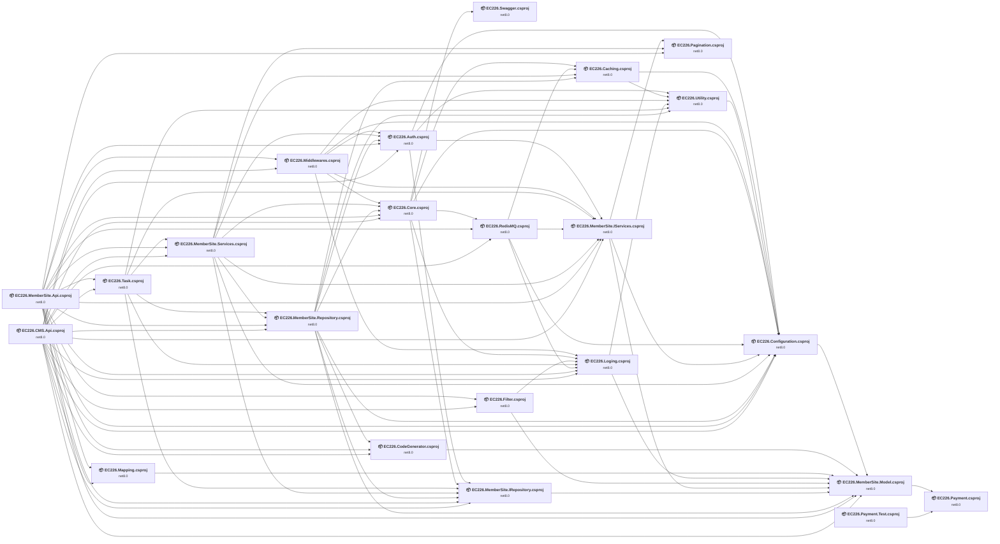

## Project Details

<a id="ec226authec226authcsproj"></a>
### EC226.Auth\EC226.Auth.csproj

#### Project Info

- **Current Target Framework:** net8.0
- **Proposed Target Framework:** net10.0
- **SDK-style**: True
- **Project Kind:** ClassLibrary
- **Dependencies**: 4
- **Dependants**: 5
- **Number of Files**: 12
- **Number of Files with Incidents**: 7
- **Lines of Code**: 940
- **Estimated LOC to modify**: 79+ (at least 8.4% of the project)

#### Dependency Graph

Legend:
📦 SDK-style project
⚙️ Classic project

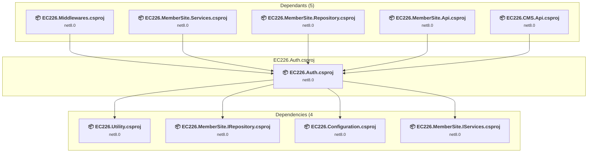

### API Compatibility

| Category | Count | Impact |
| :--- | :---: | :--- |
| 🔴 Binary Incompatible | 61 | High - Require code changes |
| 🟡 Source Incompatible | 18 | Medium - Needs re-compilation and potential conflicting API error fixing |
| 🔵 Behavioral change | 0 | Low - Behavioral changes that may require testing at runtime |
| ✅ Compatible | 844 |  |
| ***Total APIs Analyzed*** | ***923*** |  |

#### Project Technologies and Features

| Technology | Issues | Percentage | Migration Path |
| :--- | :---: | :---: | :--- |
| IdentityModel & Claims-based Security | 61 | 77.2% | Windows Identity Foundation (WIF), SAML, and claims-based authentication APIs that have been replaced by modern identity libraries. WIF was the original identity framework for .NET Framework. Migrate to Microsoft.IdentityModel.* packages (modern identity stack). |

<a id="ec226cachingec226cachingcsproj"></a>
### EC226.Caching\EC226.Caching.csproj

#### Project Info

- **Current Target Framework:** net8.0
- **Proposed Target Framework:** net10.0
- **SDK-style**: True
- **Project Kind:** ClassLibrary
- **Dependencies**: 2
- **Dependants**: 4
- **Number of Files**: 10
- **Number of Files with Incidents**: 5
- **Lines of Code**: 1189
- **Estimated LOC to modify**: 7+ (at least 0.6% of the project)

#### Dependency Graph

Legend:
📦 SDK-style project
⚙️ Classic project

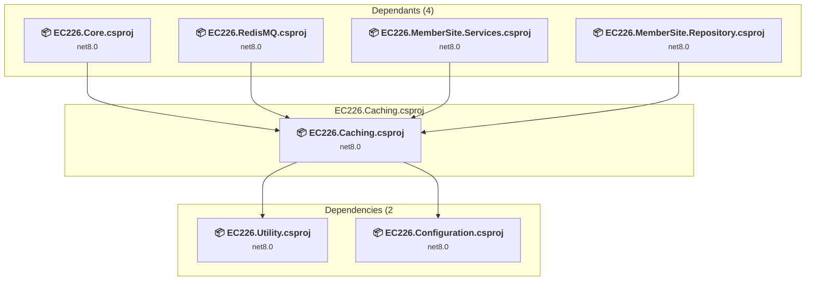

### API Compatibility

| Category | Count | Impact |
| :--- | :---: | :--- |
| 🔴 Binary Incompatible | 0 | High - Require code changes |
| 🟡 Source Incompatible | 7 | Medium - Needs re-compilation and potential conflicting API error fixing |
| 🔵 Behavioral change | 0 | Low - Behavioral changes that may require testing at runtime |
| ✅ Compatible | 810 |  |
| ***Total APIs Analyzed*** | ***817*** |  |

<a id="ec226cmsapiec226cmsapicsproj"></a>
### EC226.CMS.Api\EC226.CMS.Api.csproj

#### Project Info

- **Current Target Framework:** net8.0
- **Proposed Target Framework:** net10.0
- **SDK-style**: True
- **Project Kind:** AspNetCore
- **Dependencies**: 15
- **Dependants**: 0
- **Number of Files**: 1188
- **Number of Files with Incidents**: 4
- **Lines of Code**: 9866
- **Estimated LOC to modify**: 9+ (at least 0.1% of the project)

#### Dependency Graph

Legend:
📦 SDK-style project
⚙️ Classic project

```mermaid
flowchart TB
    subgraph current["EC226.CMS.Api.csproj"]
        MAIN["<b>📦&nbsp;EC226.CMS.Api.csproj</b><br/><small>net8.0</small>"]
        click MAIN "#ec226cmsapiec226cmsapicsproj"
    end
    subgraph downstream["Dependencies (15"]
        P1["<b>📦&nbsp;EC226.Auth.csproj</b><br/><small>net8.0</small>"]
        P6["<b>📦&nbsp;EC226.Middlewares.csproj</b><br/><small>net8.0</small>"]
        P8["<b>📦&nbsp;EC226.Core.csproj</b><br/><small>net8.0</small>"]
        P14["<b>📦&nbsp;EC226.MemberSite.Model.csproj</b><br/><small>net8.0</small>"]
        P12["<b>📦&nbsp;EC226.Task.csproj</b><br/><small>net8.0</small>"]
        P11["<b>📦&nbsp;EC226.Filter.csproj</b><br/><small>net8.0</small>"]
        P17["<b>📦&nbsp;EC226.MemberSite.IRepository.csproj</b><br/><small>net8.0</small>"]
        P18["<b>📦&nbsp;EC226.MemberSite.Repository.csproj</b><br/><small>net8.0</small>"]
        P2["<b>📦&nbsp;EC226.Configuration.csproj</b><br/><small>net8.0</small>"]
        P15["<b>📦&nbsp;EC226.MemberSite.IServices.csproj</b><br/><small>net8.0</small>"]
        P13["<b>📦&nbsp;EC226.RedisMQ.csproj</b><br/><small>net8.0</small>"]
        P7["<b>📦&nbsp;EC226.Mapping.csproj</b><br/><small>net8.0</small>"]
        P9["<b>📦&nbsp;EC226.Loging.csproj</b><br/><small>net8.0</small>"]
        P5["<b>📦&nbsp;EC226.CodeGenerator.csproj</b><br/><small>net8.0</small>"]
        P16["<b>📦&nbsp;EC226.MemberSite.Services.csproj</b><br/><small>net8.0</small>"]
        click P1 "#ec226authec226authcsproj"
        click P6 "#ec226middlewaresec226middlewarescsproj"
        click P8 "#ec226coreec226corecsproj"
        click P14 "#ec226membersitemodelec226membersitemodelcsproj"
        click P12 "#ec226taskec226taskcsproj"
        click P11 "#ec226filterec226filtercsproj"
        click P17 "#ec226membersiteirepositoryec226membersiteirepositorycsproj"
        click P18 "#ec226membersiterepositoryec226membersiterepositorycsproj"
        click P2 "#ec226configurationec226configurationcsproj"
        click P15 "#ec226membersiteiservicesec226membersiteiservicescsproj"
        click P13 "#ec226redismqec226redismqcsproj"
        click P7 "#ec226mappingec226mappingcsproj"
        click P9 "#ec226logingec226logingcsproj"
        click P5 "#ec226codegeneratorec226codegeneratorcsproj"
        click P16 "#ec226membersiteservicesec226membersiteservicescsproj"
    end
    MAIN --> P1
    MAIN --> P6
    MAIN --> P8
    MAIN --> P14
    MAIN --> P12
    MAIN --> P11
    MAIN --> P17
    MAIN --> P18
    MAIN --> P2
    MAIN --> P15
    MAIN --> P13
    MAIN --> P7
    MAIN --> P9
    MAIN --> P5
    MAIN --> P16

```

### API Compatibility

| Category | Count | Impact |
| :--- | :---: | :--- |
| 🔴 Binary Incompatible | 3 | High - Require code changes |
| 🟡 Source Incompatible | 4 | Medium - Needs re-compilation and potential conflicting API error fixing |
| 🔵 Behavioral change | 2 | Low - Behavioral changes that may require testing at runtime |
| ✅ Compatible | 14306 |  |
| ***Total APIs Analyzed*** | ***14315*** |  |

<a id="ec226codegeneratorec226codegeneratorcsproj"></a>
### EC226.CodeGenerator\EC226.CodeGenerator.csproj

#### Project Info

- **Current Target Framework:** net8.0
- **Proposed Target Framework:** net10.0
- **SDK-style**: True
- **Project Kind:** ClassLibrary
- **Dependencies**: 1
- **Dependants**: 3
- **Number of Files**: 10
- **Number of Files with Incidents**: 1
- **Lines of Code**: 517
- **Estimated LOC to modify**: 0+ (at least 0.0% of the project)

#### Dependency Graph

Legend:
📦 SDK-style project
⚙️ Classic project

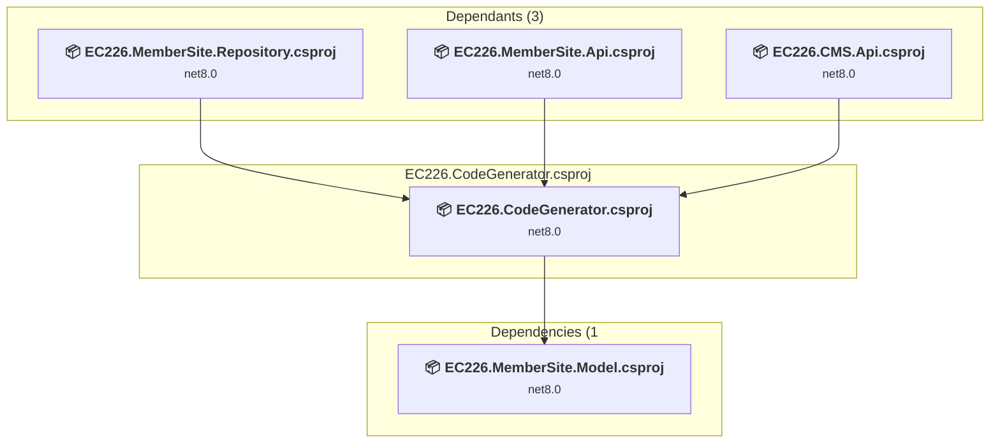

### API Compatibility

| Category | Count | Impact |
| :--- | :---: | :--- |
| 🔴 Binary Incompatible | 0 | High - Require code changes |
| 🟡 Source Incompatible | 0 | Medium - Needs re-compilation and potential conflicting API error fixing |
| 🔵 Behavioral change | 0 | Low - Behavioral changes that may require testing at runtime |
| ✅ Compatible | 892 |  |
| ***Total APIs Analyzed*** | ***892*** |  |

<a id="ec226configurationec226configurationcsproj"></a>
### EC226.Configuration\EC226.Configuration.csproj

#### Project Info

- **Current Target Framework:** net8.0
- **Proposed Target Framework:** net10.0
- **SDK-style**: True
- **Project Kind:** ClassLibrary
- **Dependencies**: 1
- **Dependants**: 11
- **Number of Files**: 6
- **Number of Files with Incidents**: 1
- **Lines of Code**: 1648
- **Estimated LOC to modify**: 0+ (at least 0.0% of the project)

#### Dependency Graph

Legend:
📦 SDK-style project
⚙️ Classic project

```mermaid
flowchart TB
    subgraph upstream["Dependants (11)"]
        P1["<b>📦&nbsp;EC226.Auth.csproj</b><br/><small>net8.0</small>"]
        P3["<b>📦&nbsp;EC226.Caching.csproj</b><br/><small>net8.0</small>"]
        P4["<b>📦&nbsp;EC226.Utility.csproj</b><br/><small>net8.0</small>"]
        P6["<b>📦&nbsp;EC226.Middlewares.csproj</b><br/><small>net8.0</small>"]
        P8["<b>📦&nbsp;EC226.Core.csproj</b><br/><small>net8.0</small>"]
        P13["<b>📦&nbsp;EC226.RedisMQ.csproj</b><br/><small>net8.0</small>"]
        P15["<b>📦&nbsp;EC226.MemberSite.IServices.csproj</b><br/><small>net8.0</small>"]
        P16["<b>📦&nbsp;EC226.MemberSite.Services.csproj</b><br/><small>net8.0</small>"]
        P18["<b>📦&nbsp;EC226.MemberSite.Repository.csproj</b><br/><small>net8.0</small>"]
        P19["<b>📦&nbsp;EC226.MemberSite.Api.csproj</b><br/><small>net8.0</small>"]
        P20["<b>📦&nbsp;EC226.CMS.Api.csproj</b><br/><small>net8.0</small>"]
        click P1 "#ec226authec226authcsproj"
        click P3 "#ec226cachingec226cachingcsproj"
        click P4 "#ec226utilityec226utilitycsproj"
        click P6 "#ec226middlewaresec226middlewarescsproj"
        click P8 "#ec226coreec226corecsproj"
        click P13 "#ec226redismqec226redismqcsproj"
        click P15 "#ec226membersiteiservicesec226membersiteiservicescsproj"
        click P16 "#ec226membersiteservicesec226membersiteservicescsproj"
        click P18 "#ec226membersiterepositoryec226membersiterepositorycsproj"
        click P19 "#ec226membersiteapiec226membersiteapicsproj"
        click P20 "#ec226cmsapiec226cmsapicsproj"
    end
    subgraph current["EC226.Configuration.csproj"]
        MAIN["<b>📦&nbsp;EC226.Configuration.csproj</b><br/><small>net8.0</small>"]
        click MAIN "#ec226configurationec226configurationcsproj"
    end
    subgraph downstream["Dependencies (1"]
        P14["<b>📦&nbsp;EC226.MemberSite.Model.csproj</b><br/><small>net8.0</small>"]
        click P14 "#ec226membersitemodelec226membersitemodelcsproj"
    end
    P1 --> MAIN
    P3 --> MAIN
    P4 --> MAIN
    P6 --> MAIN
    P8 --> MAIN
    P13 --> MAIN
    P15 --> MAIN
    P16 --> MAIN
    P18 --> MAIN
    P19 --> MAIN
    P20 --> MAIN
    MAIN --> P14

```

### API Compatibility

| Category | Count | Impact |
| :--- | :---: | :--- |
| 🔴 Binary Incompatible | 0 | High - Require code changes |
| 🟡 Source Incompatible | 0 | Medium - Needs re-compilation and potential conflicting API error fixing |
| 🔵 Behavioral change | 0 | Low - Behavioral changes that may require testing at runtime |
| ✅ Compatible | 1043 |  |
| ***Total APIs Analyzed*** | ***1043*** |  |

<a id="ec226coreec226corecsproj"></a>
### EC226.Core\EC226.Core.csproj

#### Project Info

- **Current Target Framework:** net8.0
- **Proposed Target Framework:** net10.0
- **SDK-style**: True
- **Project Kind:** ClassLibrary
- **Dependencies**: 6
- **Dependants**: 5
- **Number of Files**: 15
- **Number of Files with Incidents**: 5
- **Lines of Code**: 1143
- **Estimated LOC to modify**: 22+ (at least 1.9% of the project)

#### Dependency Graph

Legend:
📦 SDK-style project
⚙️ Classic project

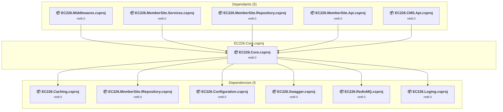

### API Compatibility

| Category | Count | Impact |
| :--- | :---: | :--- |
| 🔴 Binary Incompatible | 0 | High - Require code changes |
| 🟡 Source Incompatible | 19 | Medium - Needs re-compilation and potential conflicting API error fixing |
| 🔵 Behavioral change | 3 | Low - Behavioral changes that may require testing at runtime |
| ✅ Compatible | 1095 |  |
| ***Total APIs Analyzed*** | ***1117*** |  |

<a id="ec226filterec226filtercsproj"></a>
### EC226.Filter\EC226.Filter.csproj

#### Project Info

- **Current Target Framework:** net8.0
- **Proposed Target Framework:** net10.0
- **SDK-style**: True
- **Project Kind:** ClassLibrary
- **Dependencies**: 2
- **Dependants**: 2
- **Number of Files**: 4
- **Number of Files with Incidents**: 1
- **Lines of Code**: 265
- **Estimated LOC to modify**: 0+ (at least 0.0% of the project)

#### Dependency Graph

Legend:
📦 SDK-style project
⚙️ Classic project

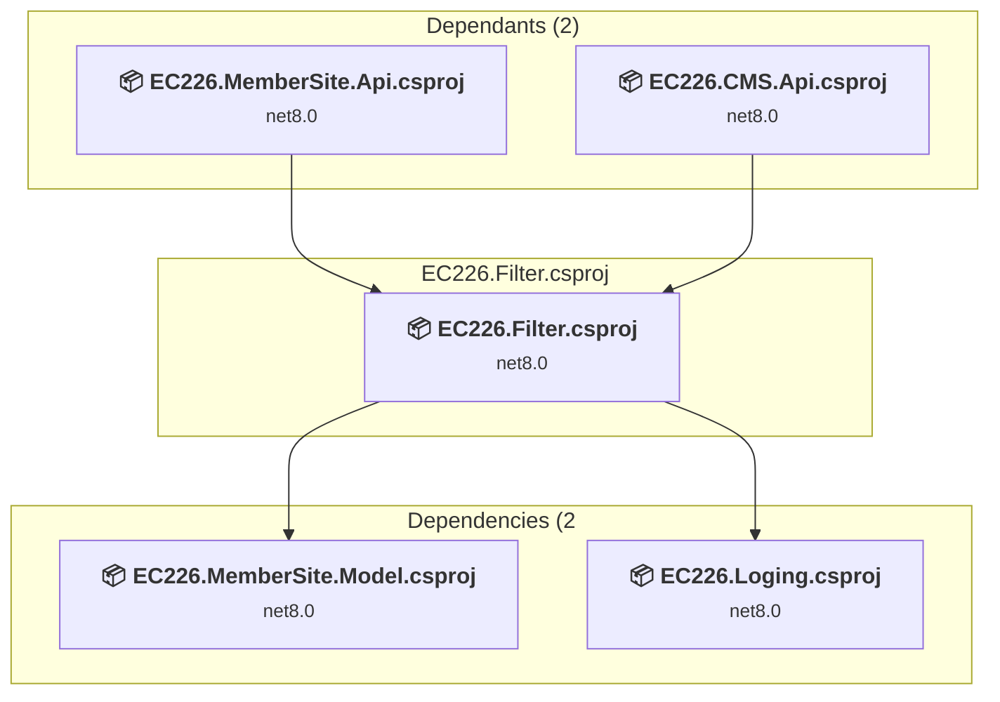

### API Compatibility

| Category | Count | Impact |
| :--- | :---: | :--- |
| 🔴 Binary Incompatible | 0 | High - Require code changes |
| 🟡 Source Incompatible | 0 | Medium - Needs re-compilation and potential conflicting API error fixing |
| 🔵 Behavioral change | 0 | Low - Behavioral changes that may require testing at runtime |
| ✅ Compatible | 282 |  |
| ***Total APIs Analyzed*** | ***282*** |  |

<a id="ec226logingec226logingcsproj"></a>
### EC226.Loging\EC226.Loging.csproj

#### Project Info

- **Current Target Framework:** net8.0
- **Proposed Target Framework:** net10.0
- **SDK-style**: True
- **Project Kind:** ClassLibrary
- **Dependencies**: 2
- **Dependants**: 7
- **Number of Files**: 2
- **Number of Files with Incidents**: 1
- **Lines of Code**: 406
- **Estimated LOC to modify**: 0+ (at least 0.0% of the project)

#### Dependency Graph

Legend:
📦 SDK-style project
⚙️ Classic project

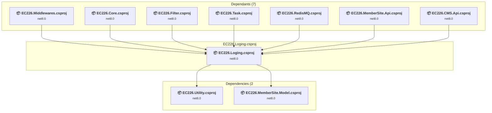

### API Compatibility

| Category | Count | Impact |
| :--- | :---: | :--- |
| 🔴 Binary Incompatible | 0 | High - Require code changes |
| 🟡 Source Incompatible | 0 | Medium - Needs re-compilation and potential conflicting API error fixing |
| 🔵 Behavioral change | 0 | Low - Behavioral changes that may require testing at runtime |
| ✅ Compatible | 533 |  |
| ***Total APIs Analyzed*** | ***533*** |  |

<a id="ec226mappingec226mappingcsproj"></a>
### EC226.Mapping\EC226.Mapping.csproj

#### Project Info

- **Current Target Framework:** net8.0
- **Proposed Target Framework:** net10.0
- **SDK-style**: True
- **Project Kind:** ClassLibrary
- **Dependencies**: 1
- **Dependants**: 2
- **Number of Files**: 2
- **Number of Files with Incidents**: 1
- **Lines of Code**: 50
- **Estimated LOC to modify**: 0+ (at least 0.0% of the project)

#### Dependency Graph

Legend:
📦 SDK-style project
⚙️ Classic project

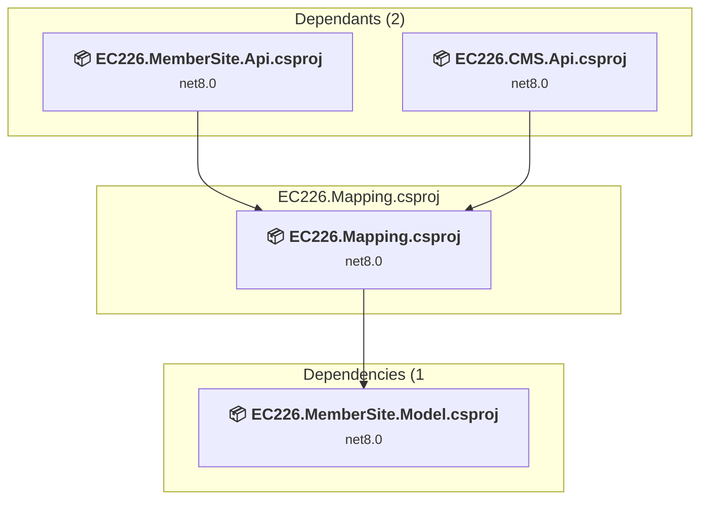

### API Compatibility

| Category | Count | Impact |
| :--- | :---: | :--- |
| 🔴 Binary Incompatible | 0 | High - Require code changes |
| 🟡 Source Incompatible | 0 | Medium - Needs re-compilation and potential conflicting API error fixing |
| 🔵 Behavioral change | 0 | Low - Behavioral changes that may require testing at runtime |
| ✅ Compatible | 25 |  |
| ***Total APIs Analyzed*** | ***25*** |  |

<a id="ec226membersiteapiec226membersiteapicsproj"></a>
### EC226.MemberSite.Api\EC226.MemberSite.Api.csproj

#### Project Info

- **Current Target Framework:** net8.0
- **Proposed Target Framework:** net10.0
- **SDK-style**: True
- **Project Kind:** AspNetCore
- **Dependencies**: 16
- **Dependants**: 0
- **Number of Files**: 41
- **Number of Files with Incidents**: 2
- **Lines of Code**: 1325
- **Estimated LOC to modify**: 5+ (at least 0.4% of the project)

#### Dependency Graph

Legend:
📦 SDK-style project
⚙️ Classic project

```mermaid
flowchart TB
    subgraph current["EC226.MemberSite.Api.csproj"]
        MAIN["<b>📦&nbsp;EC226.MemberSite.Api.csproj</b><br/><small>net8.0</small>"]
        click MAIN "#ec226membersiteapiec226membersiteapicsproj"
    end
    subgraph downstream["Dependencies (16"]
        P1["<b>📦&nbsp;EC226.Auth.csproj</b><br/><small>net8.0</small>"]
        P6["<b>📦&nbsp;EC226.Middlewares.csproj</b><br/><small>net8.0</small>"]
        P8["<b>📦&nbsp;EC226.Core.csproj</b><br/><small>net8.0</small>"]
        P14["<b>📦&nbsp;EC226.MemberSite.Model.csproj</b><br/><small>net8.0</small>"]
        P12["<b>📦&nbsp;EC226.Task.csproj</b><br/><small>net8.0</small>"]
        P21["<b>📦&nbsp;EC226.Pagination.csproj</b><br/><small>net8.0</small>"]
        P11["<b>📦&nbsp;EC226.Filter.csproj</b><br/><small>net8.0</small>"]
        P17["<b>📦&nbsp;EC226.MemberSite.IRepository.csproj</b><br/><small>net8.0</small>"]
        P18["<b>📦&nbsp;EC226.MemberSite.Repository.csproj</b><br/><small>net8.0</small>"]
        P2["<b>📦&nbsp;EC226.Configuration.csproj</b><br/><small>net8.0</small>"]
        P15["<b>📦&nbsp;EC226.MemberSite.IServices.csproj</b><br/><small>net8.0</small>"]
        P13["<b>📦&nbsp;EC226.RedisMQ.csproj</b><br/><small>net8.0</small>"]
        P7["<b>📦&nbsp;EC226.Mapping.csproj</b><br/><small>net8.0</small>"]
        P9["<b>📦&nbsp;EC226.Loging.csproj</b><br/><small>net8.0</small>"]
        P5["<b>📦&nbsp;EC226.CodeGenerator.csproj</b><br/><small>net8.0</small>"]
        P16["<b>📦&nbsp;EC226.MemberSite.Services.csproj</b><br/><small>net8.0</small>"]
        click P1 "#ec226authec226authcsproj"
        click P6 "#ec226middlewaresec226middlewarescsproj"
        click P8 "#ec226coreec226corecsproj"
        click P14 "#ec226membersitemodelec226membersitemodelcsproj"
        click P12 "#ec226taskec226taskcsproj"
        click P21 "#ec226paginationec226paginationcsproj"
        click P11 "#ec226filterec226filtercsproj"
        click P17 "#ec226membersiteirepositoryec226membersiteirepositorycsproj"
        click P18 "#ec226membersiterepositoryec226membersiterepositorycsproj"
        click P2 "#ec226configurationec226configurationcsproj"
        click P15 "#ec226membersiteiservicesec226membersiteiservicescsproj"
        click P13 "#ec226redismqec226redismqcsproj"
        click P7 "#ec226mappingec226mappingcsproj"
        click P9 "#ec226logingec226logingcsproj"
        click P5 "#ec226codegeneratorec226codegeneratorcsproj"
        click P16 "#ec226membersiteservicesec226membersiteservicescsproj"
    end
    MAIN --> P1
    MAIN --> P6
    MAIN --> P8
    MAIN --> P14
    MAIN --> P12
    MAIN --> P21
    MAIN --> P11
    MAIN --> P17
    MAIN --> P18
    MAIN --> P2
    MAIN --> P15
    MAIN --> P13
    MAIN --> P7
    MAIN --> P9
    MAIN --> P5
    MAIN --> P16

```

### API Compatibility

| Category | Count | Impact |
| :--- | :---: | :--- |
| 🔴 Binary Incompatible | 1 | High - Require code changes |
| 🟡 Source Incompatible | 0 | Medium - Needs re-compilation and potential conflicting API error fixing |
| 🔵 Behavioral change | 4 | Low - Behavioral changes that may require testing at runtime |
| ✅ Compatible | 1043 |  |
| ***Total APIs Analyzed*** | ***1048*** |  |

<a id="ec226membersiteirepositoryec226membersiteirepositorycsproj"></a>
### EC226.MemberSite.IRepository\EC226.MemberSite.IRepository.csproj

#### Project Info

- **Current Target Framework:** net8.0
- **Proposed Target Framework:** net10.0
- **SDK-style**: True
- **Project Kind:** ClassLibrary
- **Dependencies**: 1
- **Dependants**: 7
- **Number of Files**: 26
- **Number of Files with Incidents**: 1
- **Lines of Code**: 3006
- **Estimated LOC to modify**: 0+ (at least 0.0% of the project)

#### Dependency Graph

Legend:
📦 SDK-style project
⚙️ Classic project

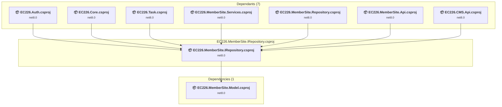

### API Compatibility

| Category | Count | Impact |
| :--- | :---: | :--- |
| 🔴 Binary Incompatible | 0 | High - Require code changes |
| 🟡 Source Incompatible | 0 | Medium - Needs re-compilation and potential conflicting API error fixing |
| 🔵 Behavioral change | 0 | Low - Behavioral changes that may require testing at runtime |
| ✅ Compatible | 634 |  |
| ***Total APIs Analyzed*** | ***634*** |  |

<a id="ec226membersiteiservicesec226membersiteiservicescsproj"></a>
### EC226.MemberSite.IServices\EC226.MemberSite.IServices.csproj

#### Project Info

- **Current Target Framework:** net8.0
- **Proposed Target Framework:** net10.0
- **SDK-style**: True
- **Project Kind:** ClassLibrary
- **Dependencies**: 3
- **Dependants**: 7
- **Number of Files**: 15
- **Number of Files with Incidents**: 1
- **Lines of Code**: 1201
- **Estimated LOC to modify**: 0+ (at least 0.0% of the project)

#### Dependency Graph

Legend:
📦 SDK-style project
⚙️ Classic project

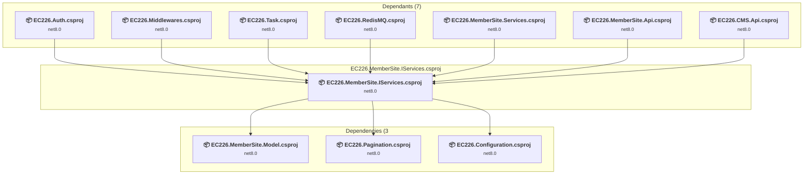

### API Compatibility

| Category | Count | Impact |
| :--- | :---: | :--- |
| 🔴 Binary Incompatible | 0 | High - Require code changes |
| 🟡 Source Incompatible | 0 | Medium - Needs re-compilation and potential conflicting API error fixing |
| 🔵 Behavioral change | 0 | Low - Behavioral changes that may require testing at runtime |
| ✅ Compatible | 353 |  |
| ***Total APIs Analyzed*** | ***353*** |  |

<a id="ec226membersitemodelec226membersitemodelcsproj"></a>
### EC226.MemberSite.Model\EC226.MemberSite.Model.csproj

#### Project Info

- **Current Target Framework:** net8.0
- **Proposed Target Framework:** net10.0
- **SDK-style**: True
- **Project Kind:** ClassLibrary
- **Dependencies**: 1
- **Dependants**: 10
- **Number of Files**: 155
- **Number of Files with Incidents**: 1
- **Lines of Code**: 7014
- **Estimated LOC to modify**: 0+ (at least 0.0% of the project)

#### Dependency Graph

Legend:
📦 SDK-style project
⚙️ Classic project

```mermaid
flowchart TB
    subgraph upstream["Dependants (10)"]
        P2["<b>📦&nbsp;EC226.Configuration.csproj</b><br/><small>net8.0</small>"]
        P5["<b>📦&nbsp;EC226.CodeGenerator.csproj</b><br/><small>net8.0</small>"]
        P7["<b>📦&nbsp;EC226.Mapping.csproj</b><br/><small>net8.0</small>"]
        P9["<b>📦&nbsp;EC226.Loging.csproj</b><br/><small>net8.0</small>"]
        P11["<b>📦&nbsp;EC226.Filter.csproj</b><br/><small>net8.0</small>"]
        P15["<b>📦&nbsp;EC226.MemberSite.IServices.csproj</b><br/><small>net8.0</small>"]
        P17["<b>📦&nbsp;EC226.MemberSite.IRepository.csproj</b><br/><small>net8.0</small>"]
        P18["<b>📦&nbsp;EC226.MemberSite.Repository.csproj</b><br/><small>net8.0</small>"]
        P19["<b>📦&nbsp;EC226.MemberSite.Api.csproj</b><br/><small>net8.0</small>"]
        P20["<b>📦&nbsp;EC226.CMS.Api.csproj</b><br/><small>net8.0</small>"]
        click P2 "#ec226configurationec226configurationcsproj"
        click P5 "#ec226codegeneratorec226codegeneratorcsproj"
        click P7 "#ec226mappingec226mappingcsproj"
        click P9 "#ec226logingec226logingcsproj"
        click P11 "#ec226filterec226filtercsproj"
        click P15 "#ec226membersiteiservicesec226membersiteiservicescsproj"
        click P17 "#ec226membersiteirepositoryec226membersiteirepositorycsproj"
        click P18 "#ec226membersiterepositoryec226membersiterepositorycsproj"
        click P19 "#ec226membersiteapiec226membersiteapicsproj"
        click P20 "#ec226cmsapiec226cmsapicsproj"
    end
    subgraph current["EC226.MemberSite.Model.csproj"]
        MAIN["<b>📦&nbsp;EC226.MemberSite.Model.csproj</b><br/><small>net8.0</small>"]
        click MAIN "#ec226membersitemodelec226membersitemodelcsproj"
    end
    subgraph downstream["Dependencies (1"]
        P22["<b>📦&nbsp;EC226.Payment.csproj</b><br/><small>net8.0</small>"]
        click P22 "#ec226paymentec226paymentcsproj"
    end
    P2 --> MAIN
    P5 --> MAIN
    P7 --> MAIN
    P9 --> MAIN
    P11 --> MAIN
    P15 --> MAIN
    P17 --> MAIN
    P18 --> MAIN
    P19 --> MAIN
    P20 --> MAIN
    MAIN --> P22

```

### API Compatibility

| Category | Count | Impact |
| :--- | :---: | :--- |
| 🔴 Binary Incompatible | 0 | High - Require code changes |
| 🟡 Source Incompatible | 0 | Medium - Needs re-compilation and potential conflicting API error fixing |
| 🔵 Behavioral change | 0 | Low - Behavioral changes that may require testing at runtime |
| ✅ Compatible | 6810 |  |
| ***Total APIs Analyzed*** | ***6810*** |  |

<a id="ec226membersiterepositoryec226membersiterepositorycsproj"></a>
### EC226.MemberSite.Repository\EC226.MemberSite.Repository.csproj

#### Project Info

- **Current Target Framework:** net8.0
- **Proposed Target Framework:** net10.0
- **SDK-style**: True
- **Project Kind:** ClassLibrary
- **Dependencies**: 8
- **Dependants**: 4
- **Number of Files**: 26
- **Number of Files with Incidents**: 1
- **Lines of Code**: 8451
- **Estimated LOC to modify**: 0+ (at least 0.0% of the project)

#### Dependency Graph

Legend:
📦 SDK-style project
⚙️ Classic project

```mermaid
flowchart TB
    subgraph upstream["Dependants (4)"]
        P12["<b>📦&nbsp;EC226.Task.csproj</b><br/><small>net8.0</small>"]
        P16["<b>📦&nbsp;EC226.MemberSite.Services.csproj</b><br/><small>net8.0</small>"]
        P19["<b>📦&nbsp;EC226.MemberSite.Api.csproj</b><br/><small>net8.0</small>"]
        P20["<b>📦&nbsp;EC226.CMS.Api.csproj</b><br/><small>net8.0</small>"]
        click P12 "#ec226taskec226taskcsproj"
        click P16 "#ec226membersiteservicesec226membersiteservicescsproj"
        click P19 "#ec226membersiteapiec226membersiteapicsproj"
        click P20 "#ec226cmsapiec226cmsapicsproj"
    end
    subgraph current["EC226.MemberSite.Repository.csproj"]
        MAIN["<b>📦&nbsp;EC226.MemberSite.Repository.csproj</b><br/><small>net8.0</small>"]
        click MAIN "#ec226membersiterepositoryec226membersiterepositorycsproj"
    end
    subgraph downstream["Dependencies (8"]
        P1["<b>📦&nbsp;EC226.Auth.csproj</b><br/><small>net8.0</small>"]
        P4["<b>📦&nbsp;EC226.Utility.csproj</b><br/><small>net8.0</small>"]
        P8["<b>📦&nbsp;EC226.Core.csproj</b><br/><small>net8.0</small>"]
        P3["<b>📦&nbsp;EC226.Caching.csproj</b><br/><small>net8.0</small>"]
        P14["<b>📦&nbsp;EC226.MemberSite.Model.csproj</b><br/><small>net8.0</small>"]
        P17["<b>📦&nbsp;EC226.MemberSite.IRepository.csproj</b><br/><small>net8.0</small>"]
        P2["<b>📦&nbsp;EC226.Configuration.csproj</b><br/><small>net8.0</small>"]
        P5["<b>📦&nbsp;EC226.CodeGenerator.csproj</b><br/><small>net8.0</small>"]
        click P1 "#ec226authec226authcsproj"
        click P4 "#ec226utilityec226utilitycsproj"
        click P8 "#ec226coreec226corecsproj"
        click P3 "#ec226cachingec226cachingcsproj"
        click P14 "#ec226membersitemodelec226membersitemodelcsproj"
        click P17 "#ec226membersiteirepositoryec226membersiteirepositorycsproj"
        click P2 "#ec226configurationec226configurationcsproj"
        click P5 "#ec226codegeneratorec226codegeneratorcsproj"
    end
    P12 --> MAIN
    P16 --> MAIN
    P19 --> MAIN
    P20 --> MAIN
    MAIN --> P1
    MAIN --> P4
    MAIN --> P8
    MAIN --> P3
    MAIN --> P14
    MAIN --> P17
    MAIN --> P2
    MAIN --> P5

```

### API Compatibility

| Category | Count | Impact |
| :--- | :---: | :--- |
| 🔴 Binary Incompatible | 0 | High - Require code changes |
| 🟡 Source Incompatible | 0 | Medium - Needs re-compilation and potential conflicting API error fixing |
| 🔵 Behavioral change | 0 | Low - Behavioral changes that may require testing at runtime |
| ✅ Compatible | 6294 |  |
| ***Total APIs Analyzed*** | ***6294*** |  |

<a id="ec226membersiteservicesec226membersiteservicescsproj"></a>
### EC226.MemberSite.Services\EC226.MemberSite.Services.csproj

#### Project Info

- **Current Target Framework:** net8.0
- **Proposed Target Framework:** net10.0
- **SDK-style**: True
- **Project Kind:** ClassLibrary
- **Dependencies**: 8
- **Dependants**: 3
- **Number of Files**: 13
- **Number of Files with Incidents**: 1
- **Lines of Code**: 3957
- **Estimated LOC to modify**: 0+ (at least 0.0% of the project)

#### Dependency Graph

Legend:
📦 SDK-style project
⚙️ Classic project

```mermaid
flowchart TB
    subgraph upstream["Dependants (3)"]
        P12["<b>📦&nbsp;EC226.Task.csproj</b><br/><small>net8.0</small>"]
        P19["<b>📦&nbsp;EC226.MemberSite.Api.csproj</b><br/><small>net8.0</small>"]
        P20["<b>📦&nbsp;EC226.CMS.Api.csproj</b><br/><small>net8.0</small>"]
        click P12 "#ec226taskec226taskcsproj"
        click P19 "#ec226membersiteapiec226membersiteapicsproj"
        click P20 "#ec226cmsapiec226cmsapicsproj"
    end
    subgraph current["EC226.MemberSite.Services.csproj"]
        MAIN["<b>📦&nbsp;EC226.MemberSite.Services.csproj</b><br/><small>net8.0</small>"]
        click MAIN "#ec226membersiteservicesec226membersiteservicescsproj"
    end
    subgraph downstream["Dependencies (8"]
        P1["<b>📦&nbsp;EC226.Auth.csproj</b><br/><small>net8.0</small>"]
        P8["<b>📦&nbsp;EC226.Core.csproj</b><br/><small>net8.0</small>"]
        P3["<b>📦&nbsp;EC226.Caching.csproj</b><br/><small>net8.0</small>"]
        P21["<b>📦&nbsp;EC226.Pagination.csproj</b><br/><small>net8.0</small>"]
        P17["<b>📦&nbsp;EC226.MemberSite.IRepository.csproj</b><br/><small>net8.0</small>"]
        P18["<b>📦&nbsp;EC226.MemberSite.Repository.csproj</b><br/><small>net8.0</small>"]
        P2["<b>📦&nbsp;EC226.Configuration.csproj</b><br/><small>net8.0</small>"]
        P15["<b>📦&nbsp;EC226.MemberSite.IServices.csproj</b><br/><small>net8.0</small>"]
        click P1 "#ec226authec226authcsproj"
        click P8 "#ec226coreec226corecsproj"
        click P3 "#ec226cachingec226cachingcsproj"
        click P21 "#ec226paginationec226paginationcsproj"
        click P17 "#ec226membersiteirepositoryec226membersiteirepositorycsproj"
        click P18 "#ec226membersiterepositoryec226membersiterepositorycsproj"
        click P2 "#ec226configurationec226configurationcsproj"
        click P15 "#ec226membersiteiservicesec226membersiteiservicescsproj"
    end
    P12 --> MAIN
    P19 --> MAIN
    P20 --> MAIN
    MAIN --> P1
    MAIN --> P8
    MAIN --> P3
    MAIN --> P21
    MAIN --> P17
    MAIN --> P18
    MAIN --> P2
    MAIN --> P15

```

### API Compatibility

| Category | Count | Impact |
| :--- | :---: | :--- |
| 🔴 Binary Incompatible | 0 | High - Require code changes |
| 🟡 Source Incompatible | 0 | Medium - Needs re-compilation and potential conflicting API error fixing |
| 🔵 Behavioral change | 0 | Low - Behavioral changes that may require testing at runtime |
| ✅ Compatible | 4796 |  |
| ***Total APIs Analyzed*** | ***4796*** |  |

<a id="ec226middlewaresec226middlewarescsproj"></a>
### EC226.Middlewares\EC226.Middlewares.csproj

#### Project Info

- **Current Target Framework:** net8.0
- **Proposed Target Framework:** net10.0
- **SDK-style**: True
- **Project Kind:** ClassLibrary
- **Dependencies**: 6
- **Dependants**: 2
- **Number of Files**: 7
- **Number of Files with Incidents**: 1
- **Lines of Code**: 580
- **Estimated LOC to modify**: 0+ (at least 0.0% of the project)

#### Dependency Graph

Legend:
📦 SDK-style project
⚙️ Classic project

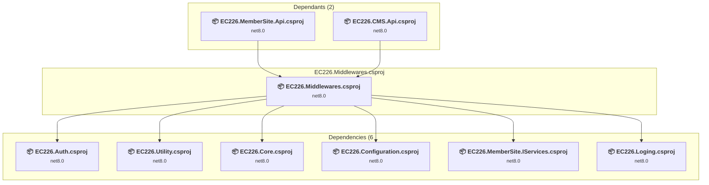

### API Compatibility

| Category | Count | Impact |
| :--- | :---: | :--- |
| 🔴 Binary Incompatible | 0 | High - Require code changes |
| 🟡 Source Incompatible | 0 | Medium - Needs re-compilation and potential conflicting API error fixing |
| 🔵 Behavioral change | 0 | Low - Behavioral changes that may require testing at runtime |
| ✅ Compatible | 644 |  |
| ***Total APIs Analyzed*** | ***644*** |  |

<a id="ec226paginationec226paginationcsproj"></a>
### EC226.Pagination\EC226.Pagination.csproj

#### Project Info

- **Current Target Framework:** net8.0
- **Proposed Target Framework:** net10.0
- **SDK-style**: True
- **Project Kind:** AspNetCore
- **Dependencies**: 0
- **Dependants**: 3
- **Number of Files**: 23
- **Number of Files with Incidents**: 1
- **Lines of Code**: 2246
- **Estimated LOC to modify**: 0+ (at least 0.0% of the project)

#### Dependency Graph

Legend:
📦 SDK-style project
⚙️ Classic project

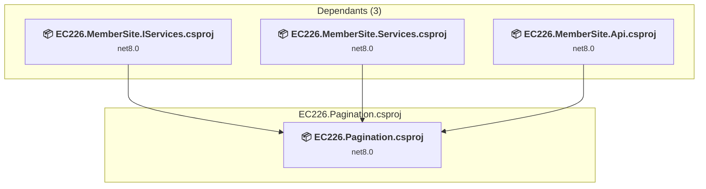

### API Compatibility

| Category | Count | Impact |
| :--- | :---: | :--- |
| 🔴 Binary Incompatible | 0 | High - Require code changes |
| 🟡 Source Incompatible | 0 | Medium - Needs re-compilation and potential conflicting API error fixing |
| 🔵 Behavioral change | 0 | Low - Behavioral changes that may require testing at runtime |
| ✅ Compatible | 1727 |  |
| ***Total APIs Analyzed*** | ***1727*** |  |

<a id="ec226paymenttestec226paymenttestcsproj"></a>
### EC226.Payment.Test\EC226.Payment.Test.csproj

#### Project Info

- **Current Target Framework:** net8.0
- **Proposed Target Framework:** net10.0
- **SDK-style**: True
- **Project Kind:** DotNetCoreApp
- **Dependencies**: 1
- **Dependants**: 0
- **Number of Files**: 3
- **Number of Files with Incidents**: 2
- **Lines of Code**: 244
- **Estimated LOC to modify**: 2+ (at least 0.8% of the project)

#### Dependency Graph

Legend:
📦 SDK-style project
⚙️ Classic project

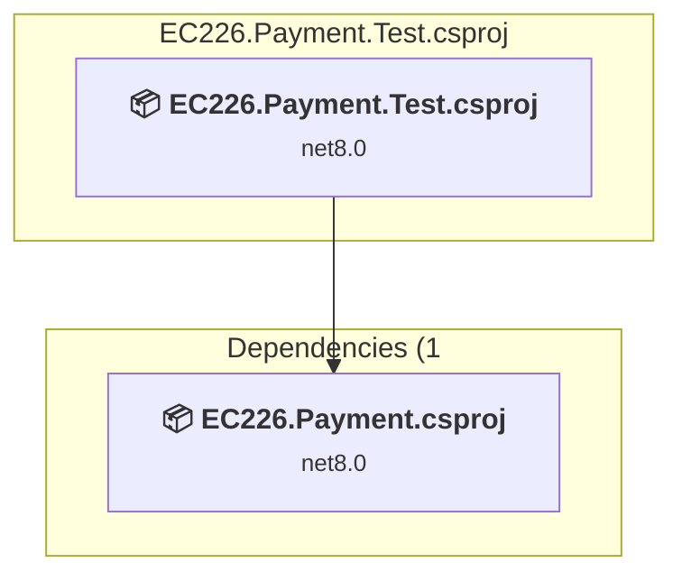

### API Compatibility

| Category | Count | Impact |
| :--- | :---: | :--- |
| 🔴 Binary Incompatible | 0 | High - Require code changes |
| 🟡 Source Incompatible | 0 | Medium - Needs re-compilation and potential conflicting API error fixing |
| 🔵 Behavioral change | 2 | Low - Behavioral changes that may require testing at runtime |
| ✅ Compatible | 226 |  |
| ***Total APIs Analyzed*** | ***228*** |  |

<a id="ec226paymentec226paymentcsproj"></a>
### EC226.Payment\EC226.Payment.csproj

#### Project Info

- **Current Target Framework:** net8.0
- **Proposed Target Framework:** net10.0
- **SDK-style**: True
- **Project Kind:** ClassLibrary
- **Dependencies**: 0
- **Dependants**: 2
- **Number of Files**: 30
- **Number of Files with Incidents**: 3
- **Lines of Code**: 3499
- **Estimated LOC to modify**: 59+ (at least 1.7% of the project)

#### Dependency Graph

Legend:
📦 SDK-style project
⚙️ Classic project

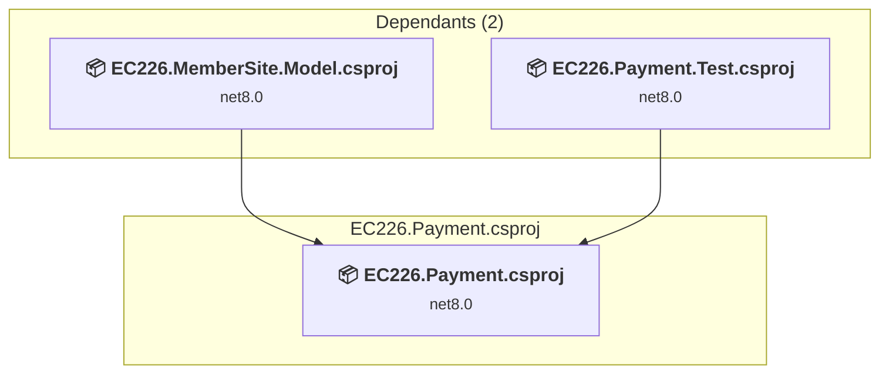

### API Compatibility

| Category | Count | Impact |
| :--- | :---: | :--- |
| 🔴 Binary Incompatible | 0 | High - Require code changes |
| 🟡 Source Incompatible | 29 | Medium - Needs re-compilation and potential conflicting API error fixing |
| 🔵 Behavioral change | 30 | Low - Behavioral changes that may require testing at runtime |
| ✅ Compatible | 3270 |  |
| ***Total APIs Analyzed*** | ***3329*** |  |

#### Project Technologies and Features

| Technology | Issues | Percentage | Migration Path |
| :--- | :---: | :---: | :--- |
| Legacy Cryptography | 2 | 3.4% | Obsolete or insecure cryptographic algorithms that have been deprecated for security reasons. These algorithms are no longer considered secure by modern standards. Migrate to modern cryptographic APIs using secure algorithms. |

<a id="ec226redismqec226redismqcsproj"></a>
### EC226.RedisMQ\EC226.RedisMQ.csproj

#### Project Info

- **Current Target Framework:** net8.0
- **Proposed Target Framework:** net10.0
- **SDK-style**: True
- **Project Kind:** ClassLibrary
- **Dependencies**: 4
- **Dependants**: 3
- **Number of Files**: 1
- **Number of Files with Incidents**: 1
- **Lines of Code**: 95
- **Estimated LOC to modify**: 0+ (at least 0.0% of the project)

#### Dependency Graph

Legend:
📦 SDK-style project
⚙️ Classic project

```mermaid
flowchart TB
    subgraph upstream["Dependants (3)"]
        P8["<b>📦&nbsp;EC226.Core.csproj</b><br/><small>net8.0</small>"]
        P19["<b>📦&nbsp;EC226.MemberSite.Api.csproj</b><br/><small>net8.0</small>"]
        P20["<b>📦&nbsp;EC226.CMS.Api.csproj</b><br/><small>net8.0</small>"]
        click P8 "#ec226coreec226corecsproj"
        click P19 "#ec226membersiteapiec226membersiteapicsproj"
        click P20 "#ec226cmsapiec226cmsapicsproj"
    end
    subgraph current["EC226.RedisMQ.csproj"]
        MAIN["<b>📦&nbsp;EC226.RedisMQ.csproj</b><br/><small>net8.0</small>"]
        click MAIN "#ec226redismqec226redismqcsproj"
    end
    subgraph downstream["Dependencies (4"]
        P3["<b>📦&nbsp;EC226.Caching.csproj</b><br/><small>net8.0</small>"]
        P2["<b>📦&nbsp;EC226.Configuration.csproj</b><br/><small>net8.0</small>"]
        P15["<b>📦&nbsp;EC226.MemberSite.IServices.csproj</b><br/><small>net8.0</small>"]
        P9["<b>📦&nbsp;EC226.Loging.csproj</b><br/><small>net8.0</small>"]
        click P3 "#ec226cachingec226cachingcsproj"
        click P2 "#ec226configurationec226configurationcsproj"
        click P15 "#ec226membersiteiservicesec226membersiteiservicescsproj"
        click P9 "#ec226logingec226logingcsproj"
    end
    P8 --> MAIN
    P19 --> MAIN
    P20 --> MAIN
    MAIN --> P3
    MAIN --> P2
    MAIN --> P15
    MAIN --> P9

```

### API Compatibility

| Category | Count | Impact |
| :--- | :---: | :--- |
| 🔴 Binary Incompatible | 0 | High - Require code changes |
| 🟡 Source Incompatible | 0 | Medium - Needs re-compilation and potential conflicting API error fixing |
| 🔵 Behavioral change | 0 | Low - Behavioral changes that may require testing at runtime |
| ✅ Compatible | 14 |  |
| ***Total APIs Analyzed*** | ***14*** |  |

<a id="ec226swaggerec226swaggercsproj"></a>
### EC226.Swagger\EC226.Swagger.csproj

#### Project Info

- **Current Target Framework:** net8.0
- **Proposed Target Framework:** net10.0
- **SDK-style**: True
- **Project Kind:** ClassLibrary
- **Dependencies**: 0
- **Dependants**: 1
- **Number of Files**: 2
- **Number of Files with Incidents**: 1
- **Lines of Code**: 65
- **Estimated LOC to modify**: 0+ (at least 0.0% of the project)

#### Dependency Graph

Legend:
📦 SDK-style project
⚙️ Classic project

```mermaid
flowchart TB
    subgraph upstream["Dependants (1)"]
        P8["<b>📦&nbsp;EC226.Core.csproj</b><br/><small>net8.0</small>"]
        click P8 "#ec226coreec226corecsproj"
    end
    subgraph current["EC226.Swagger.csproj"]
        MAIN["<b>📦&nbsp;EC226.Swagger.csproj</b><br/><small>net8.0</small>"]
        click MAIN "#ec226swaggerec226swaggercsproj"
    end
    P8 --> MAIN

```

### API Compatibility

| Category | Count | Impact |
| :--- | :---: | :--- |
| 🔴 Binary Incompatible | 0 | High - Require code changes |
| 🟡 Source Incompatible | 0 | Medium - Needs re-compilation and potential conflicting API error fixing |
| 🔵 Behavioral change | 0 | Low - Behavioral changes that may require testing at runtime |
| ✅ Compatible | 34 |  |
| ***Total APIs Analyzed*** | ***34*** |  |

<a id="ec226taskec226taskcsproj"></a>
### EC226.Task\EC226.Task.csproj

#### Project Info

- **Current Target Framework:** net8.0
- **Proposed Target Framework:** net10.0
- **SDK-style**: True
- **Project Kind:** ClassLibrary
- **Dependencies**: 6
- **Dependants**: 2
- **Number of Files**: 1
- **Number of Files with Incidents**: 1
- **Lines of Code**: 59
- **Estimated LOC to modify**: 0+ (at least 0.0% of the project)

#### Dependency Graph

Legend:
📦 SDK-style project
⚙️ Classic project

```mermaid
flowchart TB
    subgraph upstream["Dependants (2)"]
        P19["<b>📦&nbsp;EC226.MemberSite.Api.csproj</b><br/><small>net8.0</small>"]
        P20["<b>📦&nbsp;EC226.CMS.Api.csproj</b><br/><small>net8.0</small>"]
        click P19 "#ec226membersiteapiec226membersiteapicsproj"
        click P20 "#ec226cmsapiec226cmsapicsproj"
    end
    subgraph current["EC226.Task.csproj"]
        MAIN["<b>📦&nbsp;EC226.Task.csproj</b><br/><small>net8.0</small>"]
        click MAIN "#ec226taskec226taskcsproj"
    end
    subgraph downstream["Dependencies (6"]
        P4["<b>📦&nbsp;EC226.Utility.csproj</b><br/><small>net8.0</small>"]
        P17["<b>📦&nbsp;EC226.MemberSite.IRepository.csproj</b><br/><small>net8.0</small>"]
        P18["<b>📦&nbsp;EC226.MemberSite.Repository.csproj</b><br/><small>net8.0</small>"]
        P15["<b>📦&nbsp;EC226.MemberSite.IServices.csproj</b><br/><small>net8.0</small>"]
        P9["<b>📦&nbsp;EC226.Loging.csproj</b><br/><small>net8.0</small>"]
        P16["<b>📦&nbsp;EC226.MemberSite.Services.csproj</b><br/><small>net8.0</small>"]
        click P4 "#ec226utilityec226utilitycsproj"
        click P17 "#ec226membersiteirepositoryec226membersiteirepositorycsproj"
        click P18 "#ec226membersiterepositoryec226membersiterepositorycsproj"
        click P15 "#ec226membersiteiservicesec226membersiteiservicescsproj"
        click P9 "#ec226logingec226logingcsproj"
        click P16 "#ec226membersiteservicesec226membersiteservicescsproj"
    end
    P19 --> MAIN
    P20 --> MAIN
    MAIN --> P4
    MAIN --> P17
    MAIN --> P18
    MAIN --> P15
    MAIN --> P9
    MAIN --> P16

```

### API Compatibility

| Category | Count | Impact |
| :--- | :---: | :--- |
| 🔴 Binary Incompatible | 0 | High - Require code changes |
| 🟡 Source Incompatible | 0 | Medium - Needs re-compilation and potential conflicting API error fixing |
| 🔵 Behavioral change | 0 | Low - Behavioral changes that may require testing at runtime |
| ✅ Compatible | 1 |  |
| ***Total APIs Analyzed*** | ***1*** |  |

<a id="ec226utilityec226utilitycsproj"></a>
### EC226.Utility\EC226.Utility.csproj

#### Project Info

- **Current Target Framework:** net8.0
- **Proposed Target Framework:** net10.0
- **SDK-style**: True
- **Project Kind:** ClassLibrary
- **Dependencies**: 1
- **Dependants**: 6
- **Number of Files**: 30
- **Number of Files with Incidents**: 5
- **Lines of Code**: 3030
- **Estimated LOC to modify**: 14+ (at least 0.5% of the project)

#### Dependency Graph

Legend:
📦 SDK-style project
⚙️ Classic project

```mermaid
flowchart TB
    subgraph upstream["Dependants (6)"]
        P1["<b>📦&nbsp;EC226.Auth.csproj</b><br/><small>net8.0</small>"]
        P3["<b>📦&nbsp;EC226.Caching.csproj</b><br/><small>net8.0</small>"]
        P6["<b>📦&nbsp;EC226.Middlewares.csproj</b><br/><small>net8.0</small>"]
        P9["<b>📦&nbsp;EC226.Loging.csproj</b><br/><small>net8.0</small>"]
        P12["<b>📦&nbsp;EC226.Task.csproj</b><br/><small>net8.0</small>"]
        P18["<b>📦&nbsp;EC226.MemberSite.Repository.csproj</b><br/><small>net8.0</small>"]
        click P1 "#ec226authec226authcsproj"
        click P3 "#ec226cachingec226cachingcsproj"
        click P6 "#ec226middlewaresec226middlewarescsproj"
        click P9 "#ec226logingec226logingcsproj"
        click P12 "#ec226taskec226taskcsproj"
        click P18 "#ec226membersiterepositoryec226membersiterepositorycsproj"
    end
    subgraph current["EC226.Utility.csproj"]
        MAIN["<b>📦&nbsp;EC226.Utility.csproj</b><br/><small>net8.0</small>"]
        click MAIN "#ec226utilityec226utilitycsproj"
    end
    subgraph downstream["Dependencies (1"]
        P2["<b>📦&nbsp;EC226.Configuration.csproj</b><br/><small>net8.0</small>"]
        click P2 "#ec226configurationec226configurationcsproj"
    end
    P1 --> MAIN
    P3 --> MAIN
    P6 --> MAIN
    P9 --> MAIN
    P12 --> MAIN
    P18 --> MAIN
    MAIN --> P2

```

### API Compatibility

| Category | Count | Impact |
| :--- | :---: | :--- |
| 🔴 Binary Incompatible | 0 | High - Require code changes |
| 🟡 Source Incompatible | 10 | Medium - Needs re-compilation and potential conflicting API error fixing |
| 🔵 Behavioral change | 4 | Low - Behavioral changes that may require testing at runtime |
| ✅ Compatible | 2452 |  |
| ***Total APIs Analyzed*** | ***2466*** |  |

#### Project Technologies and Features

| Technology | Issues | Percentage | Migration Path |
| :--- | :---: | :---: | :--- |
| Legacy Cryptography | 8 | 57.1% | Obsolete or insecure cryptographic algorithms that have been deprecated for security reasons. These algorithms are no longer considered secure by modern standards. Migrate to modern cryptographic APIs using secure algorithms. |

